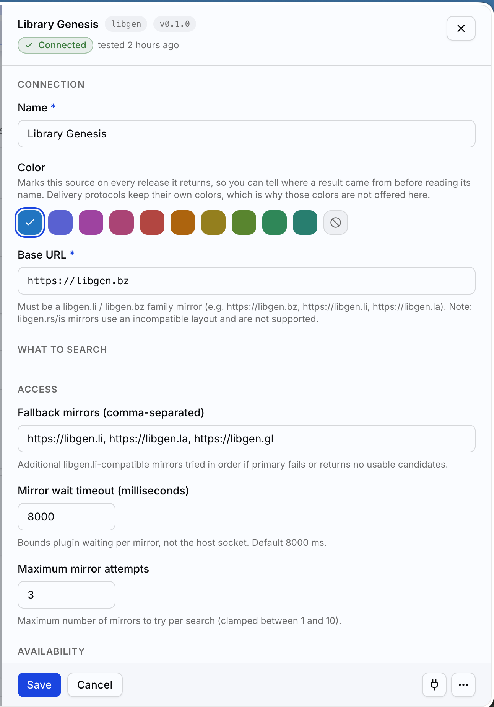

# Libgen plugin for BookOrbit

Search Library Genesis for EPUB, MOBI, PDF, AZW3, and CBZ ebooks.
No credentials or extra dependencies required. Supports BookOrbit plugin API v1.



## Install

1. Download [`index.mjs`](index.mjs) and load it through your BookOrbit
   deployment's plugin loader.
2. Configure the plugin **in BookOrbit**: settings > requests > plugins > install plugin and point it to the `index.mjs` file.
3. Run BookOrbit's connection test.

## Settings

| Setting | Default |
| --- | --- |
| Base URL (`baseUrl`) | `https://libgen.bz` |
| Fallback mirrors (`settings.fallbackMirrors`) | `https://libgen.li, https://libgen.la, https://libgen.gl` |
| Maximum mirror attempts (`settings.maxMirrorAttempts`) | `3`, including the primary |
| Per-attempt timeout (`settings.timeoutMs`) | `8000` milliseconds |

Use mirrors with the `libgen.li` / `libgen.bz` layout; `libgen.rs` / `libgen.is`
layouts aren't supported. Mirrors are tried in order. The default limit tries
only the primary and first two backups. Mirror availability isn't guaranteed.

## Security limits

To keep memory usage low and protect against malformed mirror responses, the plugin enforces a few safety limits:

- **Page size limit:** HTML responses are capped at 512 KiB to prevent runaway memory usage, cancelling oversized streams immediately.
- **HTML sanitization:** Search pages are safely parsed and stripped of HTML tags, even if the markup is malformed.
- **Format and path validation:** Download requests only accept supported ebook formats (`epub`, `mobi`, `pdf`, `azw3`, `cbz`), and file extensions are validated to prevent path traversal.

## Optional offline check

From this repository's root, with Node.js 22:

```bash
node plugins/libgen/verify.mjs
```

## AI usage disclosure

I am a professional developer, and I used AI to assist me in the development of this project.